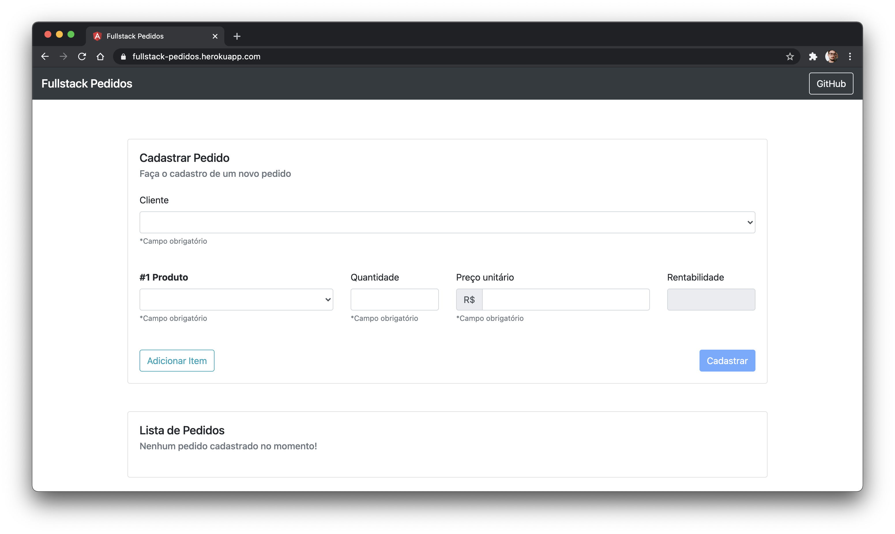

# FullstackPedidos

Sistema de controle de pedidos. De forma simples, cadastre, remova, edite e controle os seus pedidos.



# Este projeto utiliza: 

[Angular](https://angular.dev) versão 22<br>
[Express](https://expressjs.com) versão 5<br>
[Mongoose](https://mongoosejs.com) versão 9 com [MongoDB](https://www.mongodb.com) 8<br>
[Node.js](https://nodejs.org) 22.12 ou superior

## Banco de dados

O MongoDB é executado localmente via [Docker](https://www.docker.com). Com o Docker em execução:

```
docker compose up -d
npm install
npm run seed
```

O comando `npm run seed` cadastra Clientes e Produtos de exemplo e pode ser executado mais de uma vez sem duplicar os registros.

Por padrão a API se conecta em `mongodb://localhost:27017/fullstack-pedidos`. Para usar outro banco ou outra porta, copie o arquivo `.env.example` para `.env` e altere `MONGODB_URI` e `PORT`.

## Development server

Para executar localmente esta aplicação, abra uma primeira guia do terminal e execute o comando `npm start` para iniciar o servidor NodeJS da API. Em uma segunda aba do terminal execute o comando `npm run app` para iniciar a aplicação em Angular.

Acesse a aplicação em `http://localhost:4200` e a API em `http://localhost:3000`

## Build

Execute `npm run build` para gerar a versão de produção em `dist/`. Em seguida, `npm start` serve a aplicação completa (frontend e API) em `http://localhost:3000`.

## Testes

Execute o comando `npm test` para realizar os testes através do [Vitest](https://vitest.dev).

Os seguintes testes estão previstos:
<ul>
  <li>Verifica a existência do formulário de cadastro na página;</li>
  <li>Verifica a existência do formulário de edição na página;</li>
  <li>Verifica o cálculo da rentabilidade e a validação de quantidades múltiplas;</li>
  <li>Verifica as requisições para a API (com a API simulada).</li>
</ul>

## Mais Ajuda

Execute o comando `ng help` no terminal ou verifique a documentação do [Angular CLI](https://angular.dev/tools/cli).
